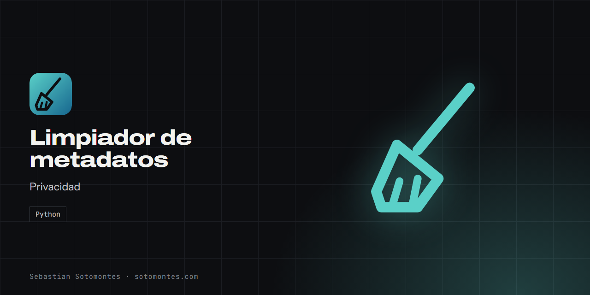
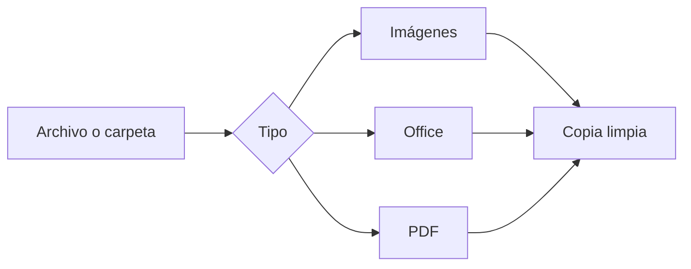

Elimina de imágenes, documentos de Office y PDF los datos ocultos como autor, fechas y ubicación GPS.

<a href="https://sotomontes.com/#limpiador-de-metadatos"><b>Ver en sotomontes.com</b></a> · <a href="#cómo-se-usa">Cómo se usa</a> · <a href="#cómo-funciona-por-dentro">Cómo funciona</a> · <a href="#novedades">Novedades</a>

| Ficha técnica | |
|---|---|
| **Autor** | Sebastian Sotomontes |
| **Tipo** | Privacidad |
| **Plataforma** | Windows, con Python |
| **Versión** | 1.0 |
| **Estado** | Funcional |
| **Stack** | Python |
| **Código** | Privado. Esta página es solo una presentación. |

---

## Qué es

Elimina los datos ocultos que viajan dentro de tus archivos: autor, nombre del PC, programa usado, fechas y, en las fotos, incluso la ubicación GPS. El contenido visible queda intacto.

## Novedades

- Limpia imágenes, Office y PDF, también por carpetas.

## Cómo se usa

1. Elige un archivo o una carpeta.
2. Ejecuta la herramienta desde la línea de comandos.
3. Revisa la copia creada con el sufijo `_limpio`.
4. Usa la opción de reemplazo solo si ya tienes copia de seguridad.

## Funciones

- **Imágenes**: JPG, PNG, TIFF, WEBP, BMP y GIF.
- **Office**: Word, Excel y PowerPoint.
- **PDF**.
- **Carpetas completas**, con subcarpetas si quieres.

## Detalles

- Por defecto no toca el original.
- Admite documentos de Office con macros.

## Cómo funciona por dentro

### Arquitectura

### Cómo funciona

Los documentos de Office son paquetes ZIP, así que la herramienta los abre y vacía sus propiedades sin tocar el contenido. Las imágenes y los PDF se tratan con su propia rutina.

---

© 2026 Sebastian Sotomontes. Todos los derechos reservados.
